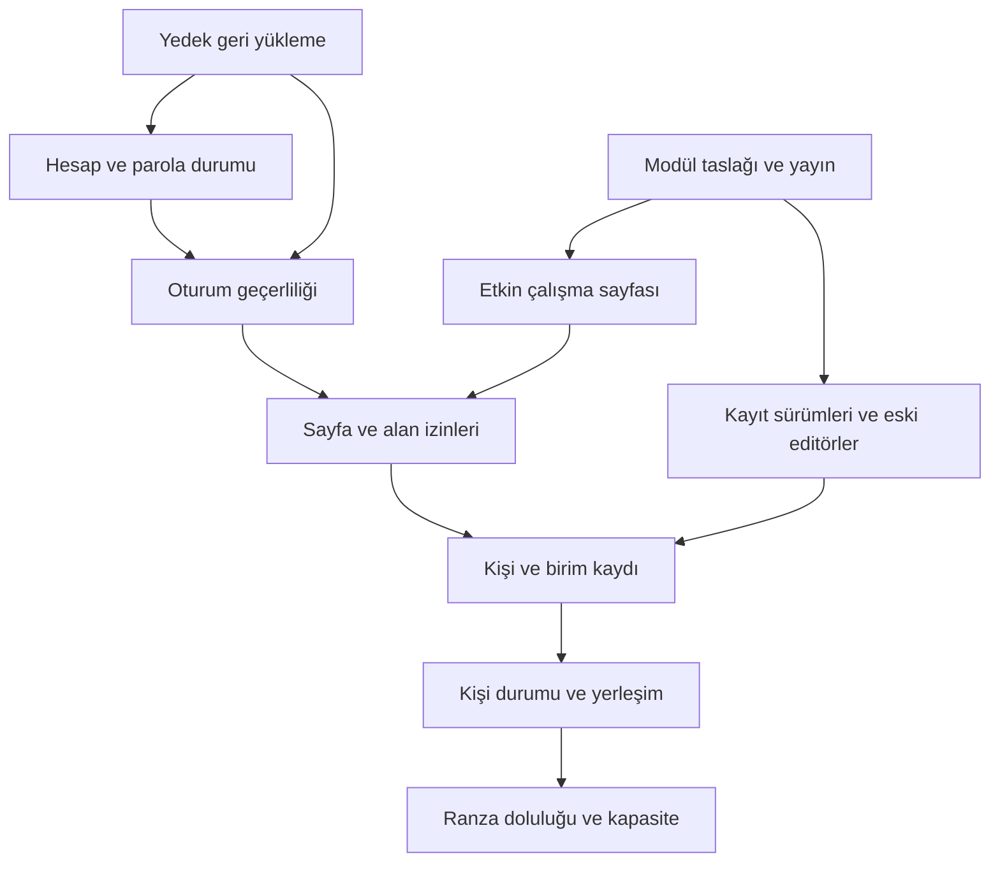

# Örtük durum makineleri incelemesi

İnceleme tarihi: 8 Kasım 2026. İncelenen uygulama: `/Applications/XAMPP/xamppfiles/htdocs` altında çalışan Laravel/Inertia/React portalı.

Bu rapor statik kod incelemesine dayanır. Üretim verileri üzerinde geçiş, silme, geri yükleme veya aktarım işlemi çalıştırılmadı. `vendor`, `node_modules`, derlenmiş dosyalar ve `eski app` arşivi kapsam dışıdır. Dosya yolları proje köküne göredir; verilen satırlar incelenen sürüme aittir.

Burada “durum makinesi”, bir olaydan sonra davranışı değişen ve sonraki işlemlerin mevcut durumuna göre kabul edildiği yapı anlamındadır. Birbirinin aynısı olan form ve liste örnekleri ortak ailelerde toplandı. Her `useState`, seçenek değeri veya veri alanı bağımsız bir iş akışı sayılmadı. Özellikle `revision` iş durumu değildir; geçişin güncel veriden yapılmasını sağlayan eşzamanlılık durumudur. Aşağıdaki envanter saptanan uygulama mekanizmalarını kapsar; statik tarama, bütün olası çalışma zamanı yollarının matematiksel eksiksizlik kanıtı değildir.

Analiz isteği kapsamında iş kuralları değiştirilmedi. İnceleme sürerken ayrıca bildirilen sol menü sorunu için yalnız `PagePolicies.tsx` ve `AppShell.tsx` içindeki bağımsız yönetim görünümü istisnası kaldırıldı; bu değişiklik aşağıda ayrı belirtilmiştir.

## 1. Kimlik, oturum ve erişim

| Yapı | Durumlar ve saklandıkları yer | Olaylar, geçiş koşulları ve korumalar | Kaynak |
|---|---|---|---|
| İlk kurulum | Hazır değil / kuruluma açık / kurulmuş. `portal_installations.installed_at`, kurulum satırının ve kullanıcıların varlığı. | İlk yönetici komutu boş ve hazırlanmış hedefte kurulum satırını kilitler; kullanıcı oluşturur ve `installed_at` yazar. İkinci kurulum reddedilir. Okuma/bağlantı hatası giriş ekranında “hazır değil” sonucuna çevrilir. | `app/Services/Security/PortalReadiness.php:11`, `InitialAdministrator.php:14`, `app/Http/Controllers/SessionController.php:25` |
| Giriş denemeleri ve hesap kilidi | Etkin/pasif hesap; kilitsiz/kilitli/kilit süresi dolmuş. `users.is_active`, `failed_login_attempts`, `locked_at`. | Yanlış parola sayacı artırır; yapılandırılmış sınıra ulaşınca kilitlenir. Kilit süresi dolunca sayaç sıfırlanır. Doğru parola kilidi/sayacı temizler. Pasif hesap giriş yapamaz. İşlem kullanıcı satırı kilidi altında yapılır. | `app/Services/Security/PortalLogin.php:16`, özellikle 24–49 |
| Oturum yaşam döngüsü | Anonim → kimliği doğrulanmış → parola değişikliği zorunlu veya kullanılabilir → geçersiz/çıkış. Session içindeki `auth_session_version`, `auth_generation`; kullanıcıdaki `session_version`, `must_change_password`, `is_active`. | Başarılı giriş session kimliğini yeniler. Her korumalı istekte sürüm ve generation karşılaştırılır. Parola zorunluluğu yalnız parola/çıkış rotalarına izin verir. Pasifleştirme, sürüm değişikliği, generation değişikliği veya çıkış oturumu sonlandırır. | `app/Http/Controllers/SessionController.php:37`, `app/Http/Middleware/EnsurePortalSession.php:15`, `app/Services/Security/SessionGeneration.php:25` |
| Kullanıcı yetki ve parola yaşam döngüsü | Personel/yönetici; etkin/pasif; geçici parolalı/normal; korumalı ana yönetici; silinmiş. `is_system_admin`, `is_active`, `must_change_password`, `is_master_admin`, `revision`, `session_version`. | Hesap oluşturma geçici parola zorunluluğu koyar. Yönetici parola sıfırlaması kilidi temizleyip oturumları geçersizleştirir. Kullanıcının doğrulanmış parola değişikliği zorunluluğu kaldırır ve kendi session sürümünü günceller. Son etkin yönetici, ana yönetici ve misafir için özel korumalar vardır; silme ayrıca açık metin onayı ister. | `app/Services/Administration/UserAdministration.php:31`, 83, 113, 148; `app/Http/Controllers/PasswordController.php:50` |
| Misafir erişimi | Kapalı/açık; misafir hesabı yok/var; yalnız okunabilir oturum. `page_permissions.target_type=misafir`, etkin `portal_pages`, `users.is_guest`. | En az bir etkin misafir giriş izni varsa misafir girişi açılır; hesap gerektiğinde oluşturulur/normalleştirilir. Erişim matrisi yazmayı kapatır. İzin verilen ve açılabilir ilk sayfa seçilir. | `app/Services/Access/GuestAccess.php:11`, `app/Services/Access/PageAccess.php:88`, `app/Http/Middleware/PortalActivity.php:16` |
| Üyelik ve parola talepleri | `new`, `read`, `completed`, `rejected`; silme sonrasında kayıt yok. `account_requests.status`, `kind`, `user_id`, `revision`, `decided_at`, `decided_by`. | Başvuru yeni kayıt açar; aynı kullanıcı/türde açık talep tekrarı engellenir. Yönetici read/new/reject/completed/approve/password/delete olaylarını uygular. Karar güncel revision, yönetici yetkisi ve işlem türüne bağlıdır. Onay kullanıcı oluşturma; password mevcut hesabın parola sıfırlamasıyla birleşir. Sonuçlanmış taleplere uygulanan koruma türlere göre farklıdır; B2'ye bakın. | `app/Services/Administration/AccountRequests.php:16`, 57–100 |
| Sayfa kataloğu | Etkin/arşivlenmiş; açılabilir/hedefi bulunamayan. `portal_pages.is_active`, `module_id`, `path`, `legacy_file`, `revision`. | Arşivleme revision + güncel izin sayısı + onayla gerçekleşir ve izinleri siler. Geri alma sayfayı etkinleştirir, eski izinleri geri getirmez. Sabit ana sayfa arşivlenemez. Dinamik modülün açılması yayımlanmış sürüm gerektirir. | `app/Services/Access/PageCatalog.php:80`, 109 |
| İzin tanımı ve etkili yetki | Tanım yok/giriş/yazma; hassas alanlarda kişisel `yok`. Sonuç: erişimsiz/salt okunur/yazabilir. `page_permissions` ve kullanıcı/birim/unvan/sayfa etkinlikleri. | grant/remove olayları sayfa revision'ını ve hedefleri doğrular. Herkes/misafir yazma alamaz; misafir hassas sayfa alamaz. Kişisel hassas izin diğer kaynakları geçersiz kılabilir; normal izinler birleşir. Yönetici için ayrı tam yetki yolu vardır. Sonuç depolanan tek bir alan değil, her kontrolde hesaplanan durumdur. | `app/Services/Access/PagePermissions.php:20`, `app/Services/Access/PageAccess.php:27`, `app/Services/Workflows/WorkflowAccess.php` |

Oturumun geçerli olması bir sayfada yazma yetkisi olduğu anlamına gelmez. Kullanıcı durumu, sayfanın etkinliği, kaynak birim/unvanın etkinliği, genel/kişisel izinler ve hassas alan politikaları iç içe çalışır. Görüntüleme için istek içi izin önbelleği vardır; yetkilendirme `matrix()` üzerinden yeniden hesaplanır (`PageAccess.php:15`, 97).

## 2. Kişi, yerleşim ve kurum iş akışları

| Yapı | Durumlar / durum taşıyıcıları | Olaylar ve geçiş koşulları | Kaynak |
|---|---|---|---|
| Kişi kaydı ve birleşik ana sayfa kaydı | Yok/mevcut/güncellenmiş; yerel form açısından güncel/eski. `people.revision`; birleşik kayıtta ayrıca `ilkgorus_revision`, `infaz_revision`, yerleşim sürümleri. | Oluşturma/düzenleme; yazma yetkisi, kimlik biçimi, güncel revision. `HomeRecords.save` kimlik, yerleşim, seçilmiş iş akışı alanlarını aynı transaction içinde kaydeder. Parçalardan birinin çatışması tüm kaydı geri alır. | `app/Services/People/PersonRecords.php:40`, `app/Services/People/HomeRecords.php:74` |
| Kişi durumu | Atanmamış veya etkin durum tanımlarından biri. Varsayılanlar: YENİ KAYIT, MEVCUT, MİSAFİR, HASTANE, ÖĞRENCİ, ÖZEL İZİN, VERİ DEĞİŞİKLİĞİ. `person_status_assignments.status_id/revision`; tanımdaki `included_in_active_list`, `counts_room`, `reserves_bed`. | Tekil/toplu durum seçimi veya içe aktarma değiştirir. Yeni seçim etkin olmalıdır; mevcut pasif değer korunabilir. Kaynak→hedef iş kuralı matrisi yoktur. `status_id=null` atamayı kaldırır. Atama silinince `status_revision` sıfırlanır. | `app/Services/Housing/PersonPlacement.php:103`, 125–175; `resources/defaults/person-statuses.json:1` |
| Yerleşim ve ranza rezervasyonu | Yerleşimsiz/kısmi/tam yerleşim; ranza boş/rezerve. `person_locations.block_id/room_id/bed_id/revision`, `housing_occupancies` satırının varlığı. | Yerleşim veya kişi durumu değişir. Blok→koğuş→ranza bağı, etkinlik, kapasite, tek kişilik ranza kontrol edilir. `reserves_bed && bed_id!=null` olduğunda doluluk oluşturulur; diğer durumlarda kaldırılır. Yer bilgisi ile rezervasyon aynı şey değildir. Aynı konumdaki eski pasif tanımlar bazı koşullarda korunabilir. | `app/Services/Housing/PersonPlacement.php:128`, özellikle 141–178 |
| Durum ve barınma tanımları | Etkin/pasif; kullanımda/boş; kapasite artırılmış/azaltılmış. `person_statuses`, `housing_blocks/rooms/beds.is_active`, davranış bayrakları, `revision`. | Tanım güncellemeleri güncel sürümle yapılır. Kullanımdaki durumun davranış bayrakları değiştirilemez. Dolu yerlerin pasifleştirilmesi ve uygunsuz kapasite daraltması engellenir. Ranza kimlikleri silinip yeniden numaralanmaz; kullanılmayan üst numaralar pasifleştirilir. | `app/Services/Statuses/StatusDefinitions.php:57`, 78; `app/Services/Housing/HousingDefinitions.php:100`, 143–158 |
| Birim iş akışı alanları | DS için 0=NORMAL, 1=DS İhlal, 2=TAHLİYE, 3=UYAP’A GİRİLDİ; diğer alanlarda seçenek kimliği veya null. `person_case_data` alanları ve her grup için `*_revision`. | Form kaydı etkin seçenek ve alan yetkisini kontrol eder; eski pasif seçenek aynı değer olarak korunabilir. Ortak alan değişirse ilgili diğer grupların revision'ları da artırılır. İlk görüş kaydı kimlik ve yerleşimi içerebilir. DS toplu sıfırlama 1/2/3→0 yapar; HMAC önizleme ve onay ister. | `app/Services/Workflows/CaseRecords.php:60`, 117–200, 204; `resources/js/lib/workflow.ts:40` |
| MESEM alt akışı | AKTİF, PASİF, UYGUN, UYGUN DEĞİL, İSTEMİYOR, MEZUN, BAŞVURU SÜRECİNDE. `mesem_durumu` seçenek kimliği; ayrıca görüşme/belge/dilekçe alanları. | Başvuru hızlı işlemi dört alanı; istemiyor işlemi iki alanı birlikte değiştirir. Etkin semantik seçenekler, yazma yetkisi ve grup revision'ı aranır. Mevcut durumun MEZUN/AKTİF olması özel engel değildir. | `app/Http/Controllers/WorkflowController.php:121`, `resources/defaults/service-workflows.json:617` |
| İzin, infaz ve zamanla değişen uygunluk | İzin türü/çıkış/dönüş alanları; DS/tahliye tarihlerine göre BELİRSİZ/gelecek/geçmiş ve UYGUN/UYGUN DEĞİL sonuçları. | Form kaydı ham alanları değiştirir; güncel tarih ilerledikçe hesaplanan sonuç değişir. Bunlar otomatik bir “izin başladı/döndü” kaydı üretmez; kişi yerleşim durumu ayrı kalır. Tarih biçimi kontrol edilir; ilişkisel tarih sırası için B4'e bakın. | `resources/defaults/person-workflows.json:150`, `app/Services/Workflows/CaseCalculations.php:28`, 62; `CaseRecords.php:68` |
| Toplu durum ve kalıcı silme | Seçilmemiş/seçilmiş/önizlenmiş/uygulanmış/eski önizleme. İstemcide ids, status, preview; sunucuda yeniden hesaplanan HMAC token. | Önizleme kişi, yerleşim, durum, ilgili kayıt sürümlerini bağlar. Uygulama aynı token'ı yeniden doğrular. Silme ayrıca KALICI SİL metni ister; durum uygulaması her kişide merkezî yerleşim servisini kullanır. | `app/Services/Institution/PersonBatchActions.php:38`, 63; `resources/js/components/PersonBatchPanel.tsx:36` |
| UYAP/sayım karşılaştırması ve kişi ekleme | Kaynak yok/yüklü/ayrıştırılmış/hatalı/temizlenmiş; mevcut/yeni kişi ayrımı. Session'da `comparison.<kind>`, `comparison-error.<kind>`; `snapshot`; seçilmiş TC'ler. | Dosya yükleme kaynak ve sonuç yazar; hata/temizleme bunları siler. XML kaynak hash'i başka pencerenin değişikliğini yakalar. Seçilen yeni kişiler eklenir ve new_record durumuna yerleşimsiz atanır. | `app/Http/Controllers/ComparisonController.php:19`, 37–109; `app/Services/Institution/PersonBatchImport.php:16`, 33 |
| Kurum kayıtlarının arşivi | Etkin/arşiv; telefon için geri alınabilir arşiv. `institution_*` veya tanımın fiziksel tablosunda `is_active`, `revision`. | Kaydetme etkin kayda; arşivleme etkinlik ve revision'a bağlıdır. Geri alma yalnız telefon kaydı ve yönetici yetkisiyle uygulanır. Diğer türlerde geri alma olmaması mevcut sözleşmedir. | `app/Services/Institution/InstitutionRecords.php:230`, 305, 329 |
| Kısmi arama tutanağı | Yeni→geçerli tutanak→iptal edilmiş tutanak. `values.result`, `cancelled_at`, `cancel_reason`, `cancelled_by`; `is_active` iptalden sonra da true. | Tutanak sonradan düzenlenemez. İptal gerekçe ve güncel revision ister; ikinci iptal engellenir. İptal edilen tutanağın arşivden farklı olarak görünür kalması bilinçli uygulanmış. | `app/Services/Institution/InstitutionRecords.php:240`, 272, 305–325 |
| Duyuru okundu bilgisi | Kullanıcı başına okunmadı/okundu. `announcement_reads` eşleşmesinin yokluğu/varlığı. | Tekil/toplu okundu işaretleme satır ekler; okunmadı yapma satırı siler. Yalnız etkin ve erişilebilir duyurular hedeflenir. | `app/Services/Institution/InstitutionRecords.php:347` |
| Nöbet atama ve senaryo onayı | Aday/uygunsuz; atanmamış/atanmış gün; hesaplanmamış/önizlenmiş/onaylanmış/eski senaryo. `users`, nöbet kayıtları `values.user_id`, `natural_key`, `revision`, uygun olmama kayıtları; HMAC token. | Otomatik üretim veya balanced/round_robin senaryosu; uygun etkin adaylar, tarih aralığı, mevcut günler ve mazeretler kontrol edilir. Senaryo uygulaması kurulum kilidi altında önizlemeyi yeniden hesaplar. Günün doğal anahtarı ikinci kaydı engeller. | `app/Services/Institution/DutyPlanning.php:14`, 82; `app/Services/Workspace/DutyScenarios.php:28`, 105; `InstitutionRecords.php:256`, 283 |
| Özel not ve fotoğraf varlığı | Not yok/var, genel/özel; fotoğraf yok/var/değiştirilmiş/silinmiş. `person_notes.is_private`, fotoğraf satırı/path/revision. | Not ekleme hassas izinlerle ayrılır; bu bir onay süreci değil eklemeli kayıttır. Fotoğraf yükleme/değiştirme/silme mevcut sürüm ve kişi erişimiyle yapılır. Kamera işlemi ayrıca istemci alt makinesidir. | `app/Http/Controllers/PersonNotesController.php:15`, 38; `PersonPhotoController.php:28`, 41 |

## 3. Dinamik modüller ve yapılandırma

| Yapı | Durumlar ve saklama | Geçiş olayları ve korumalar | Kaynak |
|---|---|---|---|
| Modül tasarım sürümü | Taslak/yayımlanmış; yayımlanmış eski sürümler + isteğe bağlı tek taslak. `module_versions.status`, `draft_slot`, `number`, `revision`; `modules.revision`. | Oluşturma taslak açar. Kaydetme yalnız güncel taslakta mümkündür. Fork en son yayından yeni taslak çıkarır; mevcut taslak varsa ikinci açılmaz. Yayınlama onay, modül/sürüm revision'ları ve kayıt snapshot'ı ister. Kayıt varsa veri şeması değişikliği engellenir. | `app/Services/Modules/ModuleDefinitions.php:19`, 39, 107; `ModulePublication.php:21`, 59 |
| Modülün çalıştırılabilirliği | Tasarım var ama çalışma sayfası yok / yayımlanmış ve etkin / sayfası arşivli / erişim yok. | Yayın sayfayı oluşturur; runtime etkin sayfa, yayımlanmış sürüm ve sayfa izni ister. Kişiye bağlı modüller ayrıca ana kişi sayfası izni ister. Yeniden yayın eski sayfayı otomatik etkinleştirmez. | `app/Services/Modules/ModulePublication.php:42`, `app/Services/Modules/ModuleAccess.php:22` |
| Modül kayıtlarının sürüm uyumu | Yeni/güncel/eski sürüme bağlı/eski editör. `module_records.version_id/revision/values/person_id`; indeks ve seçenek kullanım tabloları. | Kayıt save/runtimeSave yollarında güncel sürüm, revision, alan değerleri ve kişi bağlantısı kontrol edilir. Yayın mevcut kayıtların version_id ve revision'ını birlikte ilerletir; indeks ve seçenek snapshot'ları kayıt transaction'ıyla eşlenir. | `app/Services/Modules/ModuleRecords.php:29`, `ModulePublication.php:49` |
| Seçenek kataloğu | Liste/öğe etkin veya pasif; kayıtlar tarafından kullanılıyor/kullanılmıyor. `option_lists`, `option_items`; iş akışlarında `case_` öneki; liste revision'ı. | Liste düzenleme öğelerin kimliğini ve liste bağını korur; isim/konum/etkinlik değişir. Yeni seçimlerde etkinlik, eski kayıtların korunmasında mevcut değer dikkate alınır. Bir “seçenek” tek başına iş akışı geçiş kuralı tanımlamaz. | `app/Services/Modules/OptionCatalog.php:54`, `app/Services/Workflows/CaseRecords.php:134` |
| Birim/unvan ve hiyerarşi | Etkin/pasif/silinmiş; personele atanmış/boş; hiyerarşide kök/çocuk/gizli. `departments`, `job_titles`, `staff_nodes.parent_id/is_active/revision`. | Tanım silme etki snapshot'ını ve varsa aktarım hedefini doğrular; bağlı personeli taşır, kullanıcı revision/session_version'larını artırır. Ağaçta kendisine/alt düğümüne bağlama ve pasif üst düğüm engellenir. | `app/Services/Organization/OrganizationDefinitions.php:92`, 129; `app/Services/Organization/StaffTree.php:42`, 71 |
| Merkezî ayar, alan ve menü düzenlemesi | Varsayılan/kaydedilmiş/güncel/eski taslak. `administration_settings.values/revision`; alan ve menü tanımları; istemcide draft/selection. | Kaydetme güncel ayar revision'ı ve yönetici kontrolüyle yapılır. Görünüm, alanlar, kurul tanımları, yedek hedefleri ve planları aynı ayar sürüm mekanizmasını paylaşır. Menü erişilebilir/etkin hedeflere göre üretilir. | `app/Services/Administration/ManagementSettings.php:15`, 42; `FieldDefinitions.php`; `BoardDefinitions.php`; `app/Services/Navigation/MenuConfiguration.php:29`, 89 |
| Organizasyon aktarım eşlemesi | İçe aktarılmamış/aynı veriyle daha önce aktarılmış/kaynak veya hedef değişmiş/çakışmalı. `import_mappings.checksum`, `target_checksum`, source/target kimlikleri. | İçe aktarma yeni eşleme oluşturur; aynı snapshot tekrarında kayıtları tekrar oluşturmaz. Kaynak/hedef değişikliği sessizce ezme yerine çatışma üretir. Güvenli hedef ve transaction destekli tablo denetimleri vardır. | `app/Services/Imports/OrganizationImporter.php:12`, 23–54; `ImportTargetGuard.php:18` |

## 4. İletişim, dosyalar ve bakım

| Yapı | Durumlar ve saklama | Geçiş olayları ve korumalar | Kaynak |
|---|---|---|---|
| Kişisel mesaj | Gönderilmemiş/gönderilmiş; alıcı için okunmamış/okunmuş; her taraf için görünür/silinmiş. `personal_messages.request_id/read_at/sender_deleted/recipient_deleted`. | send/read/delete. Gönderim etkin başka alıcı ve yazma yetkisi ister. Okuma işaretleme yalnız alıcıya etki eder. Silme diğer tarafın görünürlüğünü kaldırmaz. Aynı request_id ile aynı gönderim tekrarında duplicate sonucu döner; içerik farklıysa 409. | `app/Http/Controllers/PersonalMessagesController.php:51`, 70–99 |
| Mesaj eki | Yüklü/erişilebilir → alıcı indirdi/tekrar indirme penceresi → süresi dolmuş veya silinmiş → fiziksel temizlenmiş. `expires_at`, `recipient_downloaded_at`, `download_count`, `deleted_at`, path; silme kuyruğu. | İndirme yetki, mesaj görünürlüğü ve süreyi kontrol eder. İlk alıcı indirmesi süreyi kısaltır; sonraki indirmeler uzatmaz. Ayara göre anında silme veya süre sonunda temizleme uygulanır. | `PersonalMessagesController.php:105`, özellikle 124–137; `app/Console/Commands/CleanPrivateDocuments.php:49` |
| Fiziksel dosya temizleme | Kuyrukta/yine denenecek/tamamlanmış. `private_file_deletions` satırının varlığı, `updated_at`. | DB commit sonrası veya zamanlanmış komut drain çalıştırır. Hâlâ canlı ek tarafından kullanılan veya silinemeyen dosya kuyrukta kalır; başarılı işlem satırı kaldırır. DB ve disk silmesinin birbirinden kopmaması için ayrı makinedir. | `app/Services/Operations/PrivateFileCleanup.php:13`, 27, 39 |
| Sohbet hedefi ve oda üyeliği | Oda/özel konuşma/boş hedef; üye değil/üye/sahip/genel oda. `chat_rooms`, `chat_members`, `room_id`, `recipient_id`; istemcide feed. | read/send/create/invite. Oda veya kişi seçimi birbirini dışlar. Özel alıcı etkin ve kendisinden farklı olmalıdır. Oda erişimi genel oda/sahip/üyelik üzerinden; davet genel oda veya sahip tarafından yapılır. Üyelik kaldırma/odadan ayrılma olayı mevcut serviste yoktur. | `app/Services/Institution/ChatRooms.php:14`, 23, 52 |
| Excel birleştirme çıktısı | Dosyalar seçildi/işleniyor/sonuç hazır/hatalı/süresi dolmuş/temizlenmiş. Session'da `excel-merge.result.owner/path/expires`; diskte output.xlsx. | Merge eski sonucu temizleyip yenisini kaydeder. İndirme aynı kullanıcı ve bir saatlik süre koşuluyla mümkündür. Zamanlanmış temizleyici eski dosyaları kaldırır. | `app/Http/Controllers/ExcelMergeController.php:14`, 34, 77; `CleanPrivateDocuments.php:65` |
| Yönetilen dosya ve sürümleri | Yok/mevcut/düzenlenmiş; geçmiş sürüm; çöpte/geri alınmış. Disk dosyası, geçmiş metadata'sı, checksum ve trash_id/version_id. | save/copy/move/delete/restore/version/extract. Dosya kilidi, güvenli yol/kapsam, uzantı, hedef varlığı ve save/version için eski checksum kontrol edilir. Delete fiziksel çöpe taşır; restore metadata ile geri alır. | `app/Services/Administration/ManagedFiles.php:138`, 152, 205, 278–295 |
| Yedek nesnesi ve geri yükleme | Dosya hazırlanıyor → yedek kayıtlı; doğrulanabilir/bozuk; etkin/arşivli. Restore için doğrulandı→ön yedek→bakım→uygulama→tamamlandı/geri alma. `administration_backups.sha256/archived_at/summary`; geçici `$previous`; bakım işareti; session generation. | Yedek hash, şema, tablo kümesi, dosya yolları ve etkin yönetici doğrulanır. GERİ YÜKLE onayı gerekir. Geri yükleme DB transaction'ı ve dosyalar için telafi adımları kullanır; kullanıcı sürümleri/generation ilerletilir; sonunda girişe yönlendirilir. CLI yedekleme/prova ayrıca arşiv manifesti ve izole hedef kullanır. | `app/Services/Administration/ManagedDatabase.php:134`, 242, 251–350; `app/Services/Operations/PortalBackup.php:94`, 142 |
| Zamanlanmış yedek planı | Hiç çalışmadı/Bekliyor/Başarılı/Başarısız; yerel kopya hazır/hedefe teslim edilmedi alt durumu. `administration_settings` içindeki `backup_plan_runs.items[id]`: status, attempts, retry_at, date, backup_id, last_successful_backup_id. | Zamanlayıcı etkin plan/tarih/saat/tekrar zamanı kontrol eder. Dosya kilidi aynı anda iki çalışmayı engeller. Hata 5,10,20,40,60 dakika aralıklı tekrar planlar. Kesilmiş Bekliyor tekrar alınabilir; teslim hatasında yerel kopya yeniden kullanılır. Elle çalıştırma scheduled zaman/etkinlik denetiminden geçmez. | `app/Services/Administration/BackupPlans.php:96`, 116–196 |
| Sağlık, bakım görevi ve geri yükleme provası | Henüz sonuç yok/başarılı/başarısız; son başarı bilgisi ayrıca korunur. `storage/app/private/operations/state.json`, backup/job/rehearsal bölümleri. | Komut bitişi result yazar. Prova yalnız ayrı hedef ve MySQL/MariaDB ile; dosya kilidi ikinci provayı reddeder. Raporlanan durum süreç kimliği taşıyan kalıcı “çalışıyor” kaydı değildir. | `app/Services/Operations/OperationalState.php:9`, 51; `app/Services/Workspace/BackupRehearsal.php:27`, 127 |
| SQL önizleme, dönüşüm ve sıfırlama | Hazırlanmamış/önizlenmiş/onaylanmış/uygulanmış/eski önizleme. İstemcide result/confirmation; sunucuda checksum, target_checksum; işlemin türüne göre ön yedek. | SQL aracı komut+DB hash'ini ve SQL ÇALIŞTIR metnini doğrular. Eski SQL dönüşümü kaynak ve hedef parmak izini karşılaştırır. Yapı değişikliği/sıfırlama ayrı açık metin onayları ister. Bunlar sunucuda kalıcı tek kullanımlık işlem nesnesi değildir. | `app/Services/Administration/DatabaseTools.php:105`, 163, 233; `app/Services/Administration/LegacySqlConversion.php:229`, 277 |
| Bağımsız kurtarma | Anahtar yok/geçerli/süresi dolmuş/tüketilmiş; kurtarma oturumu anonim/yetkili/süresi dolmuş. `access.json` hash/expires, ayrı CTE_RECOVERY session'ında `authorized_until`, csrf; IP başına attempts dosyası. | Yönetici 10 dakikalık anahtar üretir; başarılı kullanım kilit altında dosyayı siler. Alternatif yönetici parola doğrulaması vardır. Oturum 30 dakika geçerlidir; dakika başına deneme sınırlaması ve CSRF uygulanır. Normal portal session'ından ayrı çalışır. | `app/Services/Administration/RecoveryAccess.php:10`, `StandaloneRecovery.php:57`; `public/recovery.php:8`, 15–24 |

## 5. Tarayıcıdaki iç içe makineler

Bu aileler kalıcı iş durumlarından bağımsızdır. Örneğin MESEM durumu AKTİF kalırken düzenleyici aynı anda “kaydediliyor”, “kirli”, “çatışmalı” veya “pencere kapatma onayı bekliyor” olabilir.

| Aile | Durum değişkenleri / durumlar | Olaylar ve korumalar | Kaynak |
|---|---|---|---|
| Uygulama menüsü, ekran boyutu ve tema | `menuOpen`, `wideScreen`; türetilen `managementPage`, `fixedManagement`, `drawerOpen`; `theme` ve localStorage. | Menü düğmesi/Escape/gezinme/ekran boyutu değişimi. Geniş yönetim görünümünde sabit menü; dar ekranda drawer, focus ve inert kontrolü. Tema düğmesi tercih yazar. Bildirilen kaybolma sorunu bu makinedeki özel istisnadan kaynaklanıyordu. | `resources/js/components/AppShell.tsx:135`, 225–248 |
| Sayfa yükleme ve hata sınırı | Modül yükleniyor/yüklendi/başarısız; `PortalErrorBoundary.state.failed`. | Dinamik import veya render hatası hata sayfasına geçirir. Tekrar dene tam sayfa yenilemesi yapar. | `resources/js/lib/pageResolver.ts:43`, `resources/js/components/PageFailure.tsx:21` |
| Modal veri yükleme | Kapalı/açık-yükleniyor/açık-hazır/hatalı/tekrar deneniyor. `record`/`data`/`detail`, `error`, `attempt`, AbortController. | Kayıt seçimi açar, URL/id veya attempt değişimi yükler; kapanma/yeniden seçim eski isteği iptal eder. Modül ve iş akışı editörleri bu aileyi kullanır. | `resources/js/components/ModuleRecordDialog.tsx:6`, `WorkflowRecordModal.tsx:19`, `HomeRecordDialog.tsx:124` |
| Form ve çatışma çözümü | Temiz/kirli/kaydediliyor/doğrulama hatalı/409 çatışmalı/çözülmüş. `busy`/`processing`, requestLock/saving ref, `conflict`, baseline, revision; alan başına mine/current/boş seçimi. | Kaydet, 409 yanıtı, güncel kaydı getir, alan seçimi, yeniden kaydet. Bazı editörler conflict açıkken yeni kaydı kapatır. Birleştirme tüm gerekli seçimler tamamlanmadan sonuç üretmez. | `resources/js/pages/LeaveEditor.tsx:19`, `resources/js/components/HomeRecordDialog.tsx:149`, 231; `resources/js/lib/recordConflict.ts:11`, 28; `workflowConflict.ts` |
| Kapatma ve kayıp değişiklik koruması | Düzenleme/kapatma onayı/kapalı. `dirty`, DOM kontrol baseline'ı, `changed`, `confirmClose`, `pending.current`. | Escape, dış tıklama, kapat, gezinme veya sekme kapanması. busy sırasında kapanma engellenir; kirli formda onay açılır; devam et focus'u geri verir. | `resources/js/components/PortalDialog.tsx:29`, 43–67; `resources/js/lib/dialogDraft.ts:12`; `useUnsavedChanges.ts:4` |
| Ana kişi penceresindeki alt makineler | `mode=single/bulk/shortcuts`, visited, privateOpen, roomsOpen, childBusy; delete preview/confirmation; üstte kimlik-yerleşim-iş akışı taslakları. | Sekme/mod değişimi, özel not, boş oda seçici, önizleme ve silme. Alt formun busy durumu üst pencerenin kapanma/saklama davranışına bağlanır. | `resources/js/components/HomeRecordDialog.tsx:79`, 93, 159, 267, 308 |
| Yönetim ve politika editörleri | `selection=null/new/edit/archive/view`, catalogBusy, fieldPage; izin removal/düzenleme; alan state/items/busy/error. AdminWorkspace'te mode, selected, result, checksum ve confirmation. | Seç/düzenle/önizle/onayla/kaydet/iptal olayları. Inertia processing veya busy düğmeleri kilitler; sunucuda revision/onay ayrıca doğrulanır. Alt diyaloglar kendi yükleme ve kirli form makinelerini içerir. | `resources/js/pages/PagePolicies.tsx:221`; `resources/js/components/PageRuleEditor.tsx:57`; `PolicyFieldEditor.tsx:29`; `resources/js/pages/AdminWorkspace.tsx` |
| Liste, filtre, seçim ve canlı yenileme | Uygulanmış queryState / yerel filtre taslağı; seçili satır; hidden columns; open sütun menüsü; `visiting`, `refreshing`, `disposed`, blocked. | Arama/sıralama/filtre uygula/temizle/satır seç/20 saniyelik yenileme. Dialog, sütun menüsü, aktif giriş kontrolü, gizli belge veya devam eden gezinme varken otomatik yenileme başlamaz. Unmount devam eden yenilemeyi iptal eder. | `resources/js/pages/People.tsx:128`, 155; `WorkflowList.tsx:73`; `resources/js/components/ColumnFilterMenu.tsx:16`; `resources/js/lib/useLiveList.ts:5` |
| İletişim ve çalışma merkezi istekleri | Chat: feed, hedef, busy/lock/request. Mesajlar: selectedId/detail, readAbort, busy, requestId. Workspace: data/error/loading/attempt. | Hedef değişimi, gönderim, polling, retry. Eski okuma istekleri AbortController ile ayrılır. Kişisel mesaj requestId'si başarılı gönderimden sonra yenilenir; sunucu tekrarı ayrıca tanır. | `resources/js/pages/Chat.tsx:71`; `PersonalMessages.tsx:39`; `resources/js/lib/workspace.ts:30` |
| Belge, kimlik tasarımı, çıktı ve kamera | Seçilmiş kişiler/documentPreview/busy/manual; camera=null/kişi id'si, stream ref; belge/kimlik tasarım değerleri. | Seçim→önizleme→yazdırma. Önizleme ve kişi yoksa yazdırma kapalıdır. Kamera izni→stream→yakalama→yükleme/kapatma; mevcut stream kapatılır. Kamera bekleme iptali için B6'ya bakın. | `resources/js/pages/PersonDocuments.tsx:51`, 208–230, 288; `resources/js/components/IdentityDesigner.tsx` |
| Geçici yardımcı etkileşimler | Komut paleti open/query/active/actions; toast=null/success/error; login animasyonu yükleniyor/başladı/disposed. | Klavye/komut seçimi/aç-kapat; bildirim olayı→5 saniye→kapanma; reduced-motion ve cihaz koşullarıyla animasyon yükleme. Bunlar iş onayı veya kalıcı kayıt statüsü değildir. | `resources/js/components/CommandPalette.tsx:6`; `Toast.tsx:2`; `resources/js/lib/loginAnimation.ts`; `resources/js/pages/Login.tsx` |

## 6. Bağımlılıklar

Somut iç içe geçişler:

1. Başvuru onayı → kullanıcı oluşturma → zorunlu parola değişimi → giriş session'ı → izin matrisi.
2. Ana kişi kaydı → kimlik kaydı + iş akışı kaydı + kişi durumu + yerleşim + ranza doluluğu. Bunlar tek kullanıcı olayının farklı durum bileşenleridir; transaction birlikte başarılı olmalarını sağlar.
3. MESEM hızlı başvuru → görüşme/belge/dilekçe/durum alanları → grup revision'ı → liste yenilemesi → eski açık formda 409 olasılığı.
4. Modül yayını → sürümün published olması + sayfanın oluşturulması/adının güncellenmesi + mevcut kayıt sürümlerinin ilerletilmesi. Önceki published satırları geçmiş olarak kalır; runtime en yüksek numarayı seçer.
5. Yedek planı → yerel yedek → hedefe teslim → retention → başarı; teslim başarısızsa yerel yedek tekrar kullanılır. Plan başarısı yalnız yerel dosyanın oluşması değildir.
6. Mesaj eki → alıcı indirmesi/süre dolması → mantıksal silme → DB commit → fiziksel silme kuyruğu. Kuyruğun hatası mesaj işlemini geri döndürmez; yeniden denenir.
7. Dialog açılması → yükleme → düzenleme → kaydetme/çatışma → gerekirse kapatma onayı. Bu süreç boyunca canlı liste yenilemesi durur.

## 7. Tutarsızlıklar ve eksik geçiş kontrolleri

### B1 — SQL dönüşümünde kontrol ile uygulama arasında yarış aralığı

**Öncelik: yüksek veri bütünlüğü riski. Statik kodda kontrol sırasıyla doğrulandı; eşzamanlı yük testi yapılmadı.**

`LegacySqlConversion.php:280` hedef parmak izini karşılaştırıyor. Ardından dönüşüm ve ön yedek çalışıyor; veri değiştiren transaction ancak 287'de başlıyor. Bu transaction içinde hedef parmak izi yeniden karşılaştırılmıyor ve diğer iş yazımlarında kullanılan `portal_installations` kilidi alınmıyor. `ManagementController.php:91` bu servisi doğrudan çağırıyor.

Dolayısıyla “önizleme hâlâ güncel” koşulu doğru olduktan sonra başka bir istek hedefi değiştirebilir. Ön yedek alınması bu değişikliği geçiş kontrolüne bağlamaz. Silme/ekleme veya ayar değiştirme, kontrol edildiği andan farklı bir hedefe uygulanabilir. Öneri: hedefi koruyan ortak yazma kilidini alıp parmak izini uygulama sınırında yeniden doğrulamak; ön yedek ve uygulama tutarlılığını açıkça tanımlamak.

### B2 — Hesap taleplerinde “tamamlandı” tek bir anlama gelmiyor

**Öncelik: orta. Davranış doğrulandı; hangi anlamın istenildiği iş kararıdır.**

`AccountRequests.php:79` doğrudan `completed` işlemini completed durumuna çeviriyor; bu yol kullanıcı oluşturmaz veya parola sıfırlamaz. Bu yan etkiler yalnız approve/password dallarında var (82, 91). Böylece “tamamlandı”, hem hesap/parola işlemi yapıldı hem yalnız talep kapatıldı anlamına gelebilir.

74–77'deki koruma da asimetrik: password türünde terminal talepler yeniden açılamaz. Kullanıcı oluşturmadan completed/rejected yapılan application talebi new/read işlemiyle tekrar açılabilir; approve ile hesabı oluşturulmuş başvuruda `user_id` bunu engeller. Silme tüm bu kontrollerden önce ayrı terminal yoldur.

Öneri: izin verilen kaynak durum × olay tablosu ve `approved`, `password_reset`, `closed_without_action` gibi sonuç nedeni tanımlamak. Yeniden açma isteniyorsa ayrı, kayıt altına alınan bir olay olarak ifade etmek.

### B3 — İş akışı seçenekleri var, kaynak→hedef geçiş kuralları yok

**Öncelik: orta; hata olup olmadığı süreç beklentisine bağlı.**

`CaseRecords.php:68–78`, 130–139 alan türünü ve hedef seçeneği doğruluyor; önceki iş durumuna göre izin matrisi uygulamıyor. `WorkflowController.php:124–136` MESEM hızlı işlemleri mevcut MEZUN/AKTİF/başka durum kontrolü olmadan uyguluyor. Örneğin güncel revision'a sahip MEZUN kaydı hızlı başvuru ile BAŞVURU SÜRECİNDE yapılabilir. Normal formda belge/dilekçe/görüşme alanları da birbirinden bağımsız değiştirilebilir.

DS 0/1/2/3 için de normal kaydetme herhangi bir değerden herhangi birine izin veriyor. Kişi durumunda yalnız hedefin etkinliği kontrol ediliyor (`PersonPlacement.php:134`). Revision kontrolü eski veriyi ezmeyi engeller; iş açısından geçersiz bir geçişi tek başına engellemez.

Öneri: serbest düzeltme ile süreç ilerletmeyi ayırmak; gerçekten sıralı olması gereken akışlarda başlangıç durumu ve gerekli belge/alan koşullarını merkezî tanımlamak. “İnfaz Durumu” seçenekleri gibi sınıflandırma alanlarını zorla sıralı iş akışına dönüştürmemek.

### B4 — İzin tarihleri biçimsel olarak geçerli, birlikte tutarsız olabilir

**Öncelik: orta. Kontrol eksikliği statik olarak doğrulandı.**

`CaseRecords.php:71–85` tarih/saat biçimlerini doğruluyor; izin dönüşünün çıkıştan önce olmaması veya çıkış/dönüşün birlikte bulunması gibi ilişkisel koşullar yok. `LeaveEditor.tsx:26` değerleri bu genel kaydetme yoluna gönderiyor. Bu nedenle geçerli biçimli ama dönüşü çıkışından önce olan bir aralık kabul edilebilir.

Öneri: tarih+saat çiftlerini karşılaştırmak; gün sayısı alanının bunlardan türetilip türetilmediğini belirlemek. Ayrıca izin tarihinin kaydedilmesi kişi durumunu otomatik ÖZEL İZİN'e geçirmiyor; bu ayrım iş kuralında açık olmalı.

### B5 — Koğuş/ranza gerektiren durum, yerleşim olmadan saklanabiliyor

**Öncelik: orta; yeni kayıt için bilinçli geçici durum örneği var.**

`PersonPlacement.php:153` rezervasyonu ancak ranza da seçilmişse oluşturuyor; 157'de kapasite ancak koğuş varsa kontrol ediliyor. `counts_room` veya `reserves_bed` true olması koğuş/ranza seçimini zorunlu yapmıyor. `PersonBatchImport.php:33–45` bunu new_record ve tamamen boş yerleşimle kullanıyor. `Workspace/DataQuality.php:26–29` eksik durum/yerleşimi sonradan raporluyor.

Bu tek başına bozukluk kanıtı değildir: içe aktarılan kişinin yerleşiminin sonra tamamlanması amaçlanmış olabilir. Ancak MEVCUT gibi operasyonel bir durumda da aynı eksiklik kalabilir. Öneri: “yerleşim bekliyor” geçici durumu ve tamamlanma koşulu tanımlamak; geçici eksikliği operasyonel tamamlanmış durumdan ayırmak.

### B6 — Kamera izin isteğinin geç tamamlanmasına karşı iptal durumu eksik

**Öncelik: düşük/orta. Koşullu asenkron yarış; tarayıcıda yeniden üretilmedi.**

`PersonDocuments.tsx:60–66` unmount sırasında o anda mevcut stream'i durduruyor. Ancak `startCamera` içinde `getUserMedia` bekleniyor ve sonuç geldiğinde doğrudan stream atanıyor (208–215). Kullanıcı izin penceresi açıkken sayfadan ayrılırsa cleanup çalışabilir; daha sonra gelen stream için mounted/istek nesli kontrolü yoktur. Çakışan iki kamera isteğinde de eski yanıtın yenisini değiştirme olasılığı vardır.

Öneri: istek nesli veya disposed bayrağı; geç gelen stream'in track'lerini hemen durdurmak; izin bekleniyor durumunu görünür kılmak.

### B7 — Sohbet ve mesajlaşmanın tekrar deneme sözleşmeleri farklı

**Öncelik: düşük/orta. Fark doğrulandı; ağ hatasında çoğaltma olasılığı koşulludur.**

Kişisel mesaj gönderimi `request_id` ile tekrarları tanıyor (`PersonalMessagesController.php:81`). Sohbet gönderimi her istekte yeni satır oluşturuyor (`ChatRooms.php:67–76`); istemci lock'u aynı ekrandaki çift tıklamayı azaltıyor, yanıtı kaybolmuş isteğin tekrarını sunucuda tanımıyor. Ayrıca oda üyeliği yalnız eklenebiliyor; ayrılma/üyeyi çıkarma geçişi bulunmuyor (`ChatRooms.php:81–90`).

Öneri: sohbet için de idempotency anahtarı; üyelik iptalinin gerekli olup olmadığını belirlemek. Kişisel mesajda tekrar doğrulamasının alıcı/konu/gövdeyi karşılaştırdığı, ekin içeriğini karşılaştırmadığı da göz önünde bulundurulmalı.

### B8 — Geri yükleme başarısızlığında oturum durumu DB ile birlikte geri alınmıyor

**Öncelik: düşük; güvenli tarafta kalan fakat kullanıcıya açıklanması gereken yan etki.**

`ManagedDatabase.php:312` session generation dosyasını DB transaction'ı tamamlanmadan döndürüyor. Sonraki dosya işlemi hata verirse DB geri alınabiliyor ve `$previous` dosyaları telafi ediliyor (336–343); generation eski değerine getirilmiyor. Başarısız geri yükleme de mevcut oturumları sonlandırabilir. Bu eski oturumları canlandırmaz; güvenlik açısından koruyucudur. Fakat “işlem geri alındı” ile “oturumlar da eski kaldı” aynı değildir. Öneri: bu sonucu açıkça raporlamak ve başarısızlık senaryosu testiyle sözleşmeyi sabitlemek.

### B9 — Yönetim menüsündeki özel görünüm istisnası: düzeltildi

Erişim Politikaları `managementStandalone` geçiriyordu. Ortak `AppShell` bu bayrak yüzünden geniş ekranda `fixedManagement` değerini false yapıyor, bunun yerine geri dönüş bağlantıları gösteriyordu. Doğru route açılıyor olmasına rağmen farklı bir sayfaya gidilmiş izlenimi bundan kaynaklanıyordu.

Son isteğe uygun olarak bu tek kullanımlık prop ve özel dal kaldırıldı. Güncel kural `fixedManagement = managementPage && wideScreen` (`resources/js/components/AppShell.tsx:244`); `PagePolicies.tsx:260` ortak kabuğu kullanıyor. TypeScript + Vite üretim derlemesi başarılı. Sentetik DOM kontrolünde geniş ekranın sabit menüsü ve dar ekranın Menü düğmesiyle açılması geçti. Gerçek oturumla uçtan uca tarayıcı kontrolü yapılmadı; yerel test sunucusu açma denemesi ortamın port dinleme kısıtı nedeniyle çalışmadı.

## 8. Korunan geçişler ve önerilen öncelik

Mevcut kodda güçlü korumalar da var: birçok yazım kurulum satırı kilidini kullanıyor; kullanıcı yetkisi transaction içinde yeniden doğrulanıyor; form revision'ları eski kaydı ezmeyi engelliyor; modül yayını kayıt snapshot'ıyla korunuyor; toplu işlem ve nöbet senaryoları önizlemeyi uygulama anında tekrar hesaplıyor; ranza doluluğu kişi durumu ile aynı transaction'da değişiyor; fiziksel dosya silme commit sonrasına ayrılmış.

Önerilen sıra:

1. SQL dönüşümünün hedef kontrolünü atomik uygulama sınırına taşımak.
2. Hesap talebi sonuçlarını ve terminal durumdan dönüşleri açıklaştırmak.
3. MESEM/DS/izin için gerçekten zorunlu iş geçişlerini ve alanlar arası koşulları tanımlamak.
4. Yerleşim bekleyen kayıtları tamamlanmış operasyonel kayıtlardan ayırmak.
5. Kamera ve sohbet tekrar denemelerini sağlamlaştırmak; geri yüklemenin hata yan etkisini belgelemek.

Tek bir büyük durum makinesi yerine, kişi durumu–yerleşim, hesap–oturum, modül yayını–runtime ve yedekleme gibi sınırları ayrı tutmak uygun görünüyor. Her biri için izin verilen durumlar, olaylar, kaynak→hedef geçişleri, koşullar, yan etkiler ve başarısızlık sonucu tek yerde tanımlanmalı. Salt görünüm tercihleri ve basit filtrelerin aynı iş akışı altyapısına taşınması gerekmiyor.
