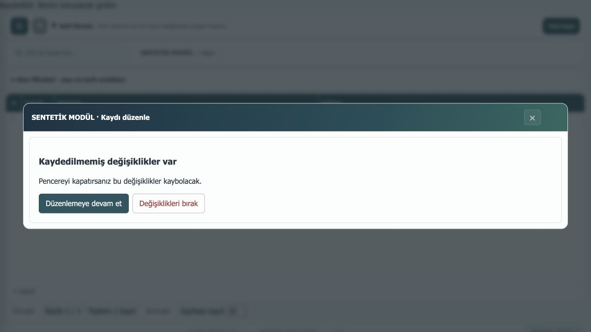
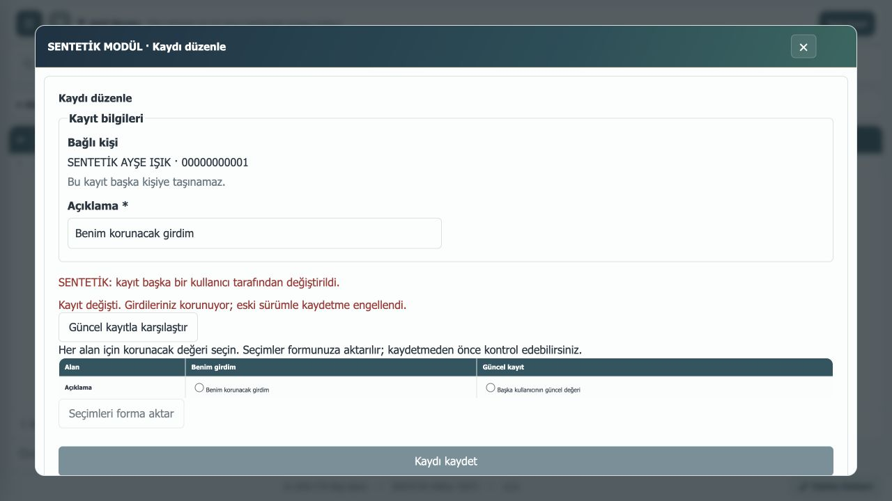
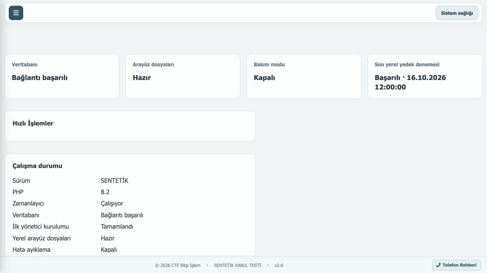

# Next Portal — Rapor doğrultusunda kod güncellemeleri

Tarih: 16 Ekim 2026  
Dayanak: [Yeniden analiz raporu](../portal-next-yeniden-analiz-20261016/RAPOR.md)

## Tamamlanan düzeltmeler

| Rapor maddesi | Uygulanan değişiklik | Doğrulama |
|---|---|---|
| B1 — Başarısız hedefte yedek birikmesi | Yedek planı denemesi yerel dosya oluşturulmadan önce kaydediliyor. Hedef teslimatı başarısızsa aynı doğrulanmış yerel kopya yeniden kullanılıyor. Zamanlanmış tekrarlar 5, 10, 20, 40, ardından en fazla 60 dakika bekliyor. Elle çalıştırma bekleme süresini aşabilir; yeni kopya üretmek yerine bekleyeni kullanır. | Ardışık üç hata, bekleme, hedefin düzelmesi, süreç kesintisi ve aynı gün başarılı çalışmadan sonraki yarım kalan tekrar senaryoları. |
| B1 — Yanıltıcı sağlık görünümü | Yerel yedek başarısı ve planın hedef teslimatı ayrı gösteriliyor. Son başarılı zaman, ardışık hata ve sonraki deneme bilgileri eklendi. | PHP sağlık testleri ve sentetik sağlık ekranı kontrolü. |
| B2 — Silinemeyen mesaj eki | Soft-delete ve kalıcı silme işi aynı transaction içinde yazılıyor. Temizlik canlı bir referansı koruyor, silinmiş referansın dosyasını kaldırabiliyor. Başarısız iş kuyrukta kalıyor. | Fiziksel silmenin false dönmesi, tekrar deneme, aktif referansın korunması, eski yetim dosyanın uzlaştırılması; SQLite ve MariaDB. |
| B3 — Mesaj/ek erişim tutarsızlığı | Ortak PersonalMessageAccess sorgusu eklendi. Mesajı kendi kutusundan silen taraf mesajı ve eki açamıyor; diğer tarafın erişimi korunuyor. | Gönderen, alıcı ve ilgisiz kullanıcı için HTTP testleri; MariaDB görünürlük kontrolü. |
| B4 — Mesaj ekleri N+1 sorgusu | Ek sayıları yalnızca mevcut sayfanın mesaj kimlikleri üzerinden tek gruplu sorguyla getiriliyor. | 80 mesajda 1 ek sayımı sorgusu; süresi dolmuş ve silinmiş ekler sayılmıyor. MariaDB üzerinde de doğrulandı. |
| U1 — Kaydedilmemiş değişiklikler | Ortak PortalDialog Escape, dış alana tıklama ve başlık kapatma işlemlerinde taslağı koruyor. Ana kişi penceresine de koruma eklendi. Düzenlemeye devam etme ve açıkça değişiklikleri bırakma seçenekleri var. | Gerçek tarayıcıda modül penceresi kontrolleri; ortak pencere ve ana kişi formu için otomatik DOM testleri. |

## Eklenen iyileştirmeler

- **Güvenilirlik görünümü:** Sağlık ekranında bekleyen dosya silme işi sayısı/en eski iş, bekleyen migration sayısı ve her yedek planının teslimat durumu görünüyor. Başarısız etkin hedef planları üstte uyarı oluşturuyor.
- **Alan bazında çakışma karşılaştırması:** Modül kaydında 409 alındığında güncel kayıt yeniden yetkilendirilmiş edit endpointinden alınabiliyor. Kullanıcının girdisi korunuyor. İki tarafın aynı alanı farklı değiştirdiği durumlarda açık seçim gerekiyor. Seçimler güncel revision ile forma aktarılıyor; otomatik kayıt yapılmıyor. Sunucu tekrar değişmişse mevcut revision kontrolü yeniden 409 veriyor. Alan tanımı/version değişmişse otomatik birleştirme engelleniyor.
- **Yarım kalan yedek teslimatı:** Süreç yerel yedek oluşturulduktan sonra durmuş olsa da plan mevcut kopyayı bulup devam edebiliyor. Aynı gün önceden tamamlanmış bir planın yarım kalan elle tekrarı da ele alınıyor.
- **Doğrulanmış hedef kopyası:** Hedefe geçici adla kopyalama, SHA-256 karşılaştırması ve son adla yayımlama uygulanıyor. Eksik hedef kopyası yenilenebiliyor. Saklama temizliği ancak yeni kopya doğrulandıktan sonra çalışıyor.
- **Temizlik izleme:** Bekleyen işler gizlenmiyor; temizlik sonunda kalan kuyruk için uyarı ve başarısız çıkış kodu üretiliyor. Laravel zamanlayıcısına beş dakikada bir temizlik eklendi. Windows'taki mevcut günlük görevle birlikte çalışma transaction kilitleriyle güvenli; CTE-Scheduler çalışıyor olmalı.
- **Bakım:** Yedek planı oluşturma/teslim/saklama adımları ayrıldı, mesaj erişim politikası merkezileştirildi, değiştirilen PHP dosyaları biçimlendirildi. Kanıtlanmamış CSS/PHP kodu silinmedi.

## Test altyapısı

Normal PHP paketine `tests/Feature/PortalReportFixesTest.php` eklendi. Önceki raporun tanı testleri tarihsel kanıt olarak docs altında kaldı; artık doğru davranışı normal regresyon paketi doğruluyor.

`npm run test:table` mevcut tablo testleriyle birlikte yeni çakışma birleştirme ve etkileşimli DOM testlerini çalıştırıyor. Bunun için yalnızca geliştirme bağımlılığı olarak `jsdom` ve kilit dosyası güncellendi. Mevcut CI aynı komutu kullandığından DOM kontrolleri de CI'a dahil oldu. DOM testleri gerçek tarayıcıda native dialog/focus trap, tarayıcı geri düğmesi veya ekran okuyucu testinin yerine geçmez.

MariaDB duman testi, `ReportFixesMariaChecks` ile genişletildi. Test kendi adı rastgele oluşturulan veritabanlarını kullanıyor, özel dosyalar için geçici depoya geçiyor ve sonunda bu kaynakları temizliyor. Canlı kaynak tablolardan kayıt kopyalanmadı.

## Korunan davranışlar ve kapsam

Veri tablolarına İşlemler sütunu eklenmedi. Satıra tıklama, klavye ile açma ve ad soyad hover davranışları korunuyor. Yazma ve alan bazında erişim kontrolleri kaldırılmadı. Taslaklar localStorage'a yazılmıyor.

Rapordaki U2, tek kullanımlık eklerin teslimat politikasıyla ilgili bir ürün kararıydı. Mevcut “alıcının ilk indirmesinde ek kaldırılır” sözleşmesi korundu; bu turdaki değişiklik fiziksel silmenin güvenilirliğini düzeltiyor. Sunucunun yanıtı hazırlaması tarayıcının dosyayı eksiksiz kaydettiğini garanti etmez. Yeniden indirme penceresi açılmadı.

Rapordaki yetki simülatörü, toplu işlem önizlemesi, vardiya devir özeti, veri kökeni paneli, komut paleti, yedek geri yükleme provası ve planlama senaryoları ayrı ürün geliştirme önerileridir. Bu güncellemede bu yeni ürünlerin tamamlandığı iddia edilmiyor; güvenilirlik görünümü ve modül çakışma karşılaştırması uygulandı.

Bu turda yeni migration yazılmadı. Önceki düzeltmelerin `2026_10_16_000021_create_private_file_deletions.php` migration'ı hâlâ gerekli. Canlı veritabanına migration, geri yükleme veya dosya uzlaştırması uygulanmadı. Arayüz yerel `public/build` alanına derlendi; dış sunucuya dağıtım yapılmadı.

## Dağıtım ve işletim

1. Hedef ortamda kurumun mevcut yedekleme/dağıtım süreciyle kodu ve derlenmiş arayüzü güncelleyin.
2. Migration durumunu kontrol edin; önceki dosya silme kuyruğu migration'ı uygulanmamışsa dağıtım sürecinde uygulayın. Sağlık ekranı eksik güncellemeleri gösterir.
3. CTE-Scheduler / Laravel zamanlayıcısının çalıştığını doğrulayın. Beş dakikalık temizlik bu zamanlayıcı üzerinden işler; her dakika yedek kontrolü aynı şekilde sürer.
4. Eski indirme hatalarından kalmış, `deleted_at` işaretli dosyalar varsa aşağıdaki uzlaştırmayı bakım sürecinde çalıştırın. Yalnızca silinmiş metadata'ya bağlı kalan dosyaları kuyruğa alır; canlı referansı olan dosya korunur. Varsayılan işlem sınırı 50'dir. Kuyruk kalırsa sonraki zamanlanmış çalıştırmalar devam eder.

```sh
php artisan portal:clean-private-documents --reconcile
```

Uzlaştırma özel dosyaları fiziksel olarak silebilir; bu komut geliştirme sırasında canlı depoda çalıştırılmadı.

## Kanıtlar

| Son kontrol | Sonuç | Kanıt |
|---|---|---|
| Genel PHP paketi | **414 test / 4.839 assertion**, 0 hata | phpunit.log, phpunit.xml |
| Frontend | **26 tablo/birleştirme + 7 etkileşimli DOM testi = 33 başarılı** | frontend.log |
| MariaDB 10.4.28 | **243 kontrol başarılı**; geçici hedef/kaynak veritabanları temizlendi | mariadb.json |
| TypeScript | Strict unused locals/parameters dahil hata yok | typescript.log |
| Üretim arayüz derlemesi | Başarılı; yerel public/build güncellendi | build.log |
| PHP sözdizimi | app/routes/database/config/tests altında **251 dosya**, hata yok | php-lint.json |
| PHP biçim kontrolü | Seçili güncellenen dosyalarda başarılı | pint.log |
| Manifest dosyaları | Manifestte listelenen bütün çıktı dosyaları mevcut | Yerel manifest kontrolü |

Gerçek tarayıcıda modül penceresinin Escape/başlık kapatma koruması, devam ederek taslağı koruma, açıkça bırakma, başarılı kayıt ve çakışma karşılaştırması sonrası kayıt gözlendi. Sağlık ekranı sentetik verilerle incelendi. Ana kişi formunun son kapatma sürümü otomatik DOM testiyle doğrulandı. Yerel test tarayıcısı native JavaScript onayında takıldığı için o senaryo özel pencereye çevrildi; son sürüm bu test aracına bağlı kalmadan otomatik olarak doğrulanıyor. Yeni bir tam tarayıcı/Windows uçtan uca test paketinin tamamlandığı iddia edilmiyor.

Plan düzenleyicisi ayrıca kontrol edildi: yeni izleme alanları kaydetme isteğine taşınmıyor; yalnızca izin verilen düzenleme alanları gönderiliyor. Bu entegrasyon için ayrı DOM regresyonu var. Sonradan yüklenen form alanlarının da kapatma korumasına katıldığı test ediliyor.

`changed-files.json` bu tur başındaki çalışma ağacıyla karşılaştırılan kaynak değişikliklerini listeler. Önceden mevcut değişiklikler geri alınmadı; bu tur kaynak dosyası silinmedi. jsdom geliştirme bağımlılığı ve paket kilidi güncellendi. Bağımlılık zafiyet taraması, gerçek Windows görev yürütümü, canlı yük testi ve tarayıcı geri düğmesinin tüm durumları bu doğrulama kapsamı dışındadır.






